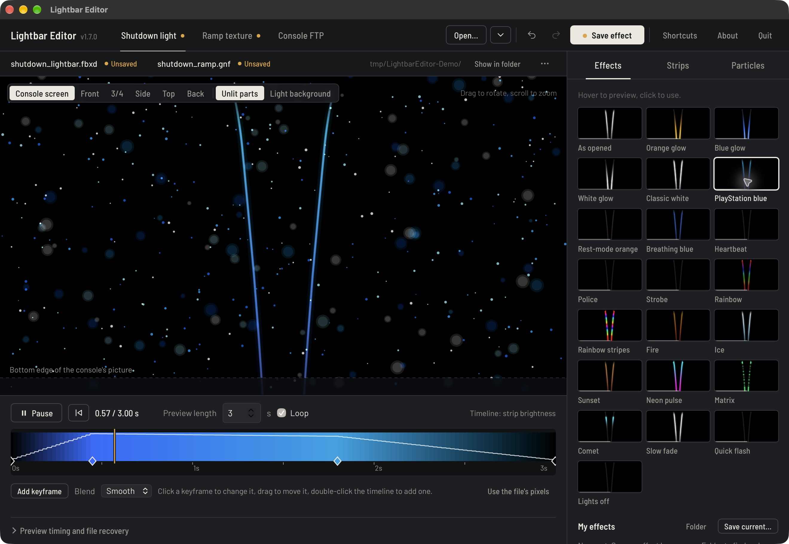
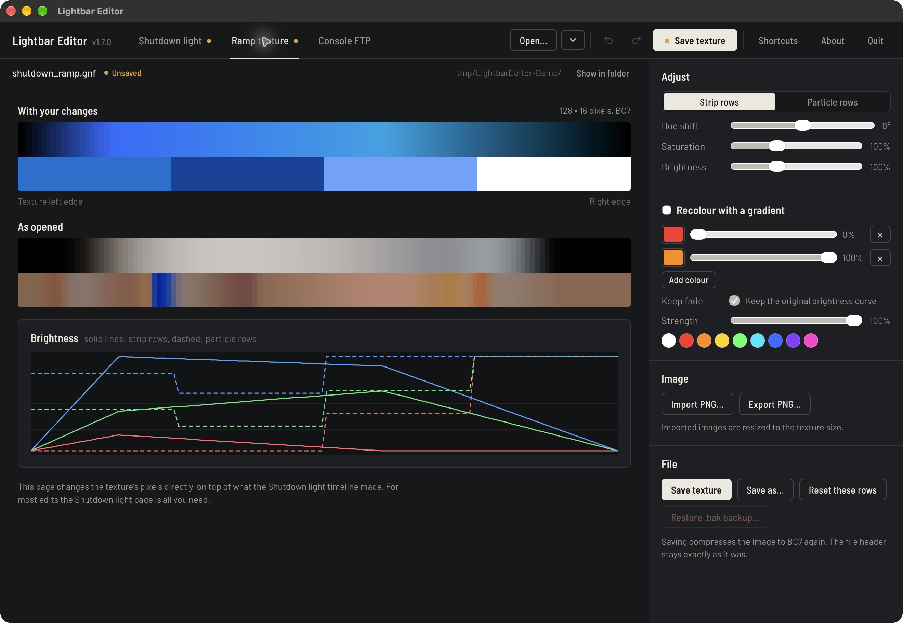
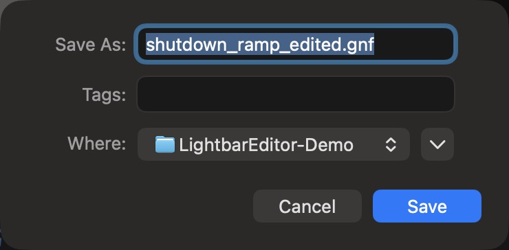

# Lightbar Editor for macOS

Apple Silicon port of SaveEditors/LightbarEditor 1.7.0, licensed GPL-3.0-only.

The original editor and Go asset/FTP implementation run in a macOS WKWebView window. AppKit Open/Save sheets, Finder reveal, Command shortcuts, clipboard menus, About, and an unsaved-changes quit prompt are added. Settings and backups use `~/Library/Application Support/LightbarEditor`.

## Install

Download the macOS DMG and SHA256SUMS from the [macOS preview release](https://github.com/appleforever11/LightbarEditor/releases/tag/macos-v1.7.0-preview.1). Verify the checksum, open the DMG, and drag Lightbar Editor to Applications. The preview is Developer ID signed when built with SIGN_IDENTITY, but is not notarized. No console assets or credentials are included.

## Screenshots







## Build

Requires macOS 13+, Xcode command-line tools, and Go 1.24+. The build script uses the adjacent verified Go toolchain when present, or Go from PATH. Set GO_BIN to override it.

```
./script/build_and_run.sh --verify
./script/build_and_run.sh --build-only
```

The app is produced at `dist/Lightbar Editor.app`. The default build is ad hoc signed. Set SIGN_IDENTITY to a Developer ID Application identity to sign with hardened runtime and timestamps. Notarization is optional via NOTARY_PROFILE in the package script; it requires your own configured credentials. No console assets are included. Retain source, GPL, and dependency notices when redistributing.

## Validation

Go tests, vet, and all 21 particle-theme regression checks pass. Native app window and Open/Save sheets were verified on Apple Silicon with downloaded console assets. A Matrix preset was saved as separate FBXD/GNF copies; both pass backend structure verification. Original downloaded files remain byte-identical.

Console modification/FTP upload is not part of this verification. The upstream upload review, backup, and readback workflow is retained; actual console visual testing remains separate.

## Port notes

The upstream checked-in go.mod and go.sum were filled with NUL bytes at the cloned revision. The module was recreated, FTP pinned to github.com/jlaffaye/ftp v0.2.4, and checksums generated by Go. Editor/backend code remains in source/; the native host is macOS/main.swift.

This edits the on-screen shutdown effect, not physical LEDs. The desktop preview is approximate.

## Packaging

```sh
SIGN_IDENTITY="Developer ID Application: Your Name (TEAMID)" ./script/build_and_run.sh --build-only
SIGN_IDENTITY="Developer ID Application: Your Name (TEAMID)" ./script/package_dmg.sh
# Optional: NOTARY_PROFILE=your-keychain-profile ./script/package_dmg.sh
```

The DMG includes the app, Applications shortcut, install instructions, GPL license, and third-party notices. SHA256SUMS is generated after signing. The macOS GitHub Actions workflow builds and tests an ad hoc signed DMG; it does not require signing secrets.

The app icon was generated for this port and is included as PNG and ICNS. No Apple or PlayStation logos are used.

See [validation details and remaining platform checks](docs/TESTING_MACOS.md).
