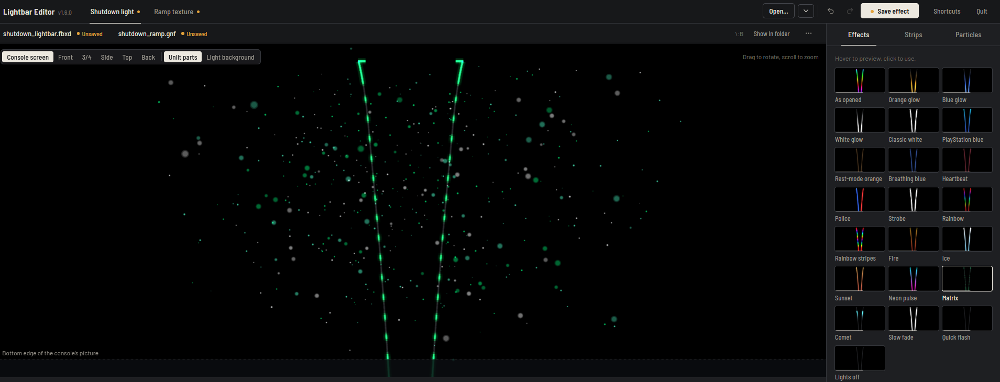
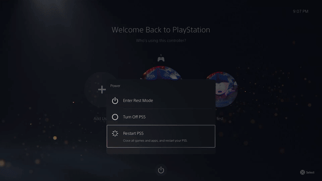
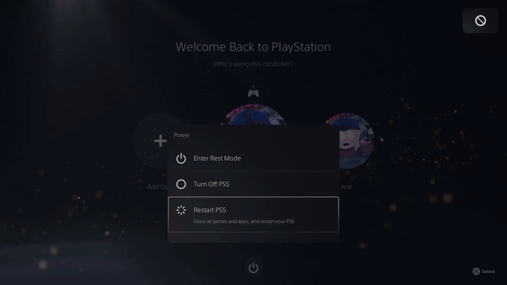

# Lightbar Editor

**Customize the PS5 shutdown-screen lightbar.** Edit strip colors, particle palettes and ramp textures in a local desktop interface, then transfer your saved assets to the console over FTP.

Author: **SaveEditors** · Windows x64 and macOS 13+ · **GPL-3.0-only**



## Console demonstrations

These recordings show customized shutdown-screen assets during a PS5 restart. The GIF previews play automatically and loop. Click a preview to open the original MP4. The editor screenshot above shows version 1.6.0; version 1.7.0 adds Console FTP and About.

| Multicolor strips | Segmented strips |
| --- | --- |
| [](docs/media/shutdown-demo-01.mp4) | [](docs/media/shutdown-demo-02.mp4) |
| [Watch video · 7 seconds](docs/media/shutdown-demo-01.mp4) | [Watch video · 9 seconds](docs/media/shutdown-demo-02.mp4) |

## Features

- Lightbar mesh preview with console-screen, front, side, top and other viewing angles.
- Built-in color presets, independent strip controls and particle palette editing.
- Matching particle palettes for every theme. Custom particle colors stay in place when you switch themes; enable **Use theme particle colors** to resume automatic matching.
- Ramp texture adjustments, PNG import/export and BC7 re-encoding.
- Undo/redo, reusable presets, save-as copies and local `.bak` recovery.
- Optional FTP downloads and reviewed uploads with console backups and byte-for-byte readback verification.
- Portable executable with embedded interface and fonts. No Python, Node.js or Go installation is needed to run it.

## macOS app

The macOS port provides the same editor in a dedicated window, native Open/Save sheets, Finder reveal, Command shortcuts and a Apple Silicon app bundle. See [macOS installation, screenshots and build instructions](MACOS.md).

## Requirements

- A Windows x64 PC with a modern web browser, or macOS 13+ for the macOS app.
- Your own supported `shutdown_lightbar.fbxd` and `shutdown_ramp.gnf` files. Console assets are **not distributed** with this project.
- For FTP: a console setup that already provides an FTP server and the required read/write access, on a trusted local network.

Supported mesh files use the single-mesh lightbar layout. Supported ramp textures contain one linear BC7 image without mipmaps. Other layouts are rejected; compatibility across console firmware versions is not established.

## Get started

1. Download **LightbarEditor.exe** from [Releases](https://github.com/SaveEditors/LightbarEditor/releases/latest). Save it to a writable folder. License notices and SHA-256 checksums are available alongside the executable.
2. Run `LightbarEditor.exe`. The editor opens in your browser; keep its program window running while editing.
3. Open either asset. The matching asset opens automatically when it is in the same folder. Alternatively, use **Console FTP → Download pair**.
4. Choose a preset or adjust the strips, particles and ramp texture. Use **Save effect** to save the pair.
5. Transfer the saved pair using the instructions below. Check the result on the console.

## Transfer to the console

The usual asset folder is `/system_ex/vsh_asset`. Both filenames must remain:

```text
shutdown_lightbar.fbxd
shutdown_ramp.gnf
```

### Built-in FTP

1. Start the console's FTP server. Open **Console FTP** in the editor.
2. Enter your console's address and FTP port. The port defaults to `1337`; change it to match your server. Enter credentials if required.
3. Confirm the remote asset folder, then choose **Check connection** or **Download pair**. Downloads create a new local working folder and open both files.
4. Edit the pair and save your changes. Return to **Console FTP → Review upload**.
5. Review the destination, filenames and verified backup folder. Choose **Upload this pair** to write the files.
6. Wait for successful readback verification. Refresh the console's active asset view and restart as required by your setup.

Connection details stay in memory for the current session; the editor does not save FTP credentials. FTP is unencrypted, so use a trusted network. Each upload review expires after 10 minutes. Changed local or remote files require a fresh review and backup.

### Manual FTP

Use an FTP client with the same address, port and remote folder. **Download and retain both existing console files first**, then upload your saved pair in binary transfer mode, replacing the same filenames. Download them again and compare them with your local copies. Restore both originals from your backup if needed.

Read [Transfer and recovery](docs/TRANSFER.md) for backup locations, overlay considerations and failure recovery.

## Preview and compatibility

The desktop preview is approximate. Its playback controls and experimental animation previews do not establish the console's ramp sampling or shutdown timing. These videos demonstrate captured results, not compatibility with every preset or firmware.

FTP verification confirms the bytes in the selected remote folder. An overlay, separate mount or cached asset view can prevent those bytes from being used immediately. Follow the requirements of your existing console setup; the editor does not mount overlays or run payloads.

This project edits the **on-screen shutdown effect**. Physical case-light control, audio editing and ShellUI background customization are outside its scope.

## Files, settings and recovery

Existing local files receive a `.bak` backup on their first save, without replacing an existing backup. **Reset to as opened** restores the in-memory starting state; it is not a factory-default download. Keep independent reference copies of your console assets.

Settings, presets, FTP working downloads and console backups use the current user's application configuration folder (`%APPDATA%\LightbarEditor` on Windows). Moving the executable does not move these files. Console backups include a manifest with destination and SHA-256 hashes; they contain no FTP credentials.

## Build from source

Go 1.24 or later is required. From `source/`:

```sh
go mod download
go test ./...
go vet ./...
go build -trimpath -ldflags "-s -w" -o LightbarEditor.exe .
```

The pinned FTP dependency is recorded in `go.mod` and `go.sum`. See [build instructions](source/BUILD.txt) and [third-party notices](THIRD_PARTY_LICENSES.txt).

The source for each release is published directly in this repository under its version tag. Executable downloads are attached to GitHub Releases; a separate source ZIP is not shipped as a release asset.

## Support and license

Report reproducible problems through [GitHub Issues](https://github.com/SaveEditors/LightbarEditor/issues). Include the app version, Windows version, action taken and exact error. For rendering issues, include console firmware and a short capture when possible. Remove credentials, private addresses and personal paths from public reports. Do not upload proprietary console assets.

Copyright © 2026 SaveEditors. Licensed under the **GNU General Public License, version 3 only**; see [LICENSE](LICENSE). Third-party components retain their own licenses. Distributed without warranty.

Independent software; not affiliated with or endorsed by Sony Interactive Entertainment. PlayStation and PS5 are trademarks of their respective owners.
